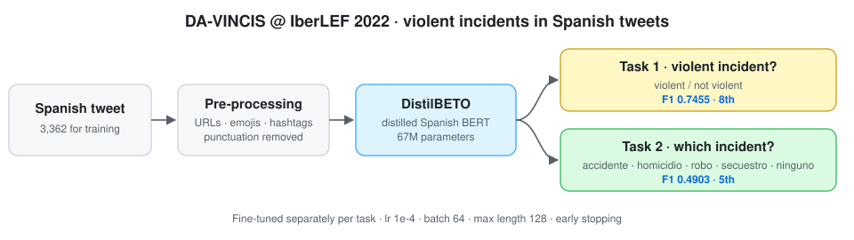

<div align="center">

# Detecting Aggressive and Violent Incidents in Spanish Social Media
### CIC-atnafu at DA-VINCIS @ IberLEF 2022 — a language-specific pre-trained model (DistilBETO)

[](https://ceur-ws.org/Vol-3202/davincis-paper2.pdf)
[](https://doi.org/10.26342/2022-69-18)
[](#installation)
[](LICENSE)
[](https://github.com/marif561/IberLEF-SEPLN-Behavior-Detection/actions/workflows/tests.yml)

Code and results for **"Detection of Aggressive and Violent Incidents from Social Media in Spanish using Pre-trained Language Model"**, *Proceedings of IberLEF 2022*, CEUR Workshop Proceedings Vol-3202.

Atnafu Lambebo Tonja · **Muhammad Arif** · Olga Kolesnikova · Alexander Gelbukh · Grigori Sidorov

*Centro de Investigación en Computación, Instituto Politécnico Nacional (CIC-IPN), Mexico City*

</div>

---

## About the paper

Aggressive language, violence and bullying are increasingly common on social media, and detecting them automatically is an active NLP research area. This paper describes the CIC team's system for the **DA-VINCIS** shared task at IberLEF 2022. The task is to detect tweets in Spanish that report violent incidents and then identify what kind of incident each one describes. Instead of a multilingual model, the system fine-tunes a **language-specific** pre-trained model, **DistilBETO**. This is a distilled, 67M-parameter version of the Spanish BERT model BETO, which keeps training light. It reaches an **F1 of 0.7455** on violent event identification and **0.4903** on violent event category recognition.

<p align="center">
  
</p>

## The tasks

| Task | Question | Labels |
|---|---|---|
| **Task 1**: violent event identification | Does the tweet report a violent incident? | violent incident · not violent incident |
| **Task 2**: violent event category recognition | What kind of incident is it? | accidente (accident) · homicidio (homicide) · robo (theft) · secuestro (kidnapping) · ninguno (none) |

The training set has **3,362 Spanish tweets** collected because they relate to violent incidents.

## Method

| Step | Details |
|---|---|
| Pre-processing | Remove URLs, emojis, hashtags, punctuation and other unwanted characters |
| Model | **DistilBETO**: distilled Spanish BERT, 67M parameters |
| Training | Adam · learning rate 1e-4 · batch 64 · max length 128 · dropout 0.2 · up to 10 epochs with early stopping on validation |

Training used Hugging Face Transformers on Google Colab Pro+. Settings are in [`configs/distilbeto.yaml`](configs/distilbeto.yaml).

## Results

Official DA-VINCIS leaderboard excerpts reported in the paper:

**Task 1: violent event identification (8th place)**

| Team | Precision | Recall | F1 |
|---|:-:|:-:|:-:|
| LuisArellano | 0.82 | 0.82 | 0.7817 |
| danielvallejo237 | 0.80 | 0.75 | 0.7759 |
| sdamian | 0.76 | 0.75 | 0.7562 |
| pturon | 0.82 | 0.70 | 0.7555 |
| Bernardo | 0.78 | 0.73 | 0.7548 |
| ITAINNOVA | 0.79 | 0.72 | 0.7529 |
| Abu | 0.76 | 0.74 | 0.7480 |
| **CIC-atnafu (ours)** | **0.76** | **0.73** | **0.7455** |

**Task 2: violent event category recognition (5th place)**

| Team | Precision | Recall | F1 |
|---|:-:|:-:|:-:|
| kelven | 0.55 | 0.55 | 0.5543 |
| pturon | 0.53 | 0.53 | 0.5286 |
| ITAINNOVA | 0.50 | 0.50 | 0.5046 |
| LuisArellano | 0.46 | 0.57 | 0.4981 |
| **CIC-atnafu (ours)** | **0.49** | **0.49** | **0.4903** |

On Task 1, the light 67M-parameter model finished within 0.04 F1 of the winner. Task 2 is much harder for every team, with top F1 around 0.55. CSV copies are in [`results/`](results/).

## Repository structure

```
.
├── configs/distilbeto.yaml  # Training settings from the paper
├── data/                    # Expected format + tiny invented sample
├── docs/figures/            # Pipeline diagram
├── results/                 # Leaderboard tables as CSV
├── scripts/run_all.sh       # Train both tasks
├── tests/                   # Unit tests (CI on every push)
└── src/davincis/
    ├── preprocess.py        # URL / emoji / hashtag / punctuation removal
    ├── data.py              # Loading and label mapping for both tasks
    ├── metrics.py           # Binary, macro and weighted F1
    ├── train.py             # Fine-tune DistilBETO (or any Spanish encoder)
    └── predict.py           # Label new tweets
```

## Installation

```bash
git clone https://github.com/marif561/IberLEF-SEPLN-Behavior-Detection.git
cd IberLEF-SEPLN-Behavior-Detection
python -m venv .venv && source .venv/bin/activate
pip install -r requirements.txt
pip install -e .
```

## Data

The DA-VINCIS data comes from the shared-task organisers and is not redistributed here. Convert it to CSV with a text column and a label column. See [`data/README.md`](data/README.md).

## Usage

```bash
# Task 1: violent vs. not violent
python -m davincis.train --task 1 --train data/train.csv --dev data/dev.csv --test data/test.csv

# Task 2: incident category (label column "category")
python -m davincis.train --task 2 --label-col category --train data/train.csv --dev data/dev.csv --test data/test.csv

# Try another Spanish model
python -m davincis.train --task 1 --model dccuchile/bert-base-spanish-wwm-cased --train data/train.csv --dev data/dev.csv

# Label new tweets
python -m davincis.predict --model outputs/task1/model --input new_tweets.csv --output predictions.csv
```

> **Note.** `src/` is a clean reference implementation of the setup in the paper. The paper doesn't give the exact Hugging Face checkpoint, so the default is the public DistilBETO model `dccuchile/distilbert-base-spanish-uncased`. The paper also doesn't say which F1 average Task 2 uses, so the code reports macro and weighted F1. If your copy of the Task 2 data has more than one category per tweet, add `--multilabel`.

## Citation

```bibtex
@inproceedings{tonja2022davincis,
  title     = {Detection of Aggressive and Violent Incidents from Social Media in {Spanish}
               using Pre-trained Language Model},
  author    = {Tonja, Atnafu Lambebo and Arif, Muhammad and Kolesnikova, Olga and
               Gelbukh, Alexander and Sidorov, Grigori},
  booktitle = {Proceedings of the Iberian Languages Evaluation Forum (IberLEF 2022)},
  series    = {CEUR Workshop Proceedings},
  volume    = {3202},
  year      = {2022},
  url       = {https://ceur-ws.org/Vol-3202/davincis-paper2.pdf}
}
```

Please also cite the task overview: *Overview of DA-VINCIS at IberLEF 2022: Detection of Aggressive and Violent Incidents from Social Media in Spanish*, Procesamiento del Lenguaje Natural 69 (2022), [doi:10.26342/2022-69-18](https://doi.org/10.26342/2022-69-18).

## Acknowledgements

Partially supported by CONACYT grant A1-S-47854, SIP-IPN grants 20220852, 20220859 and 20221627, the Deep Learning Platform for Language Technologies at INAOE, and the Microsoft Latin America PhD Award.

## License

Code is released under the [MIT License](LICENSE). The DA-VINCIS data is subject to the organisers' terms.
